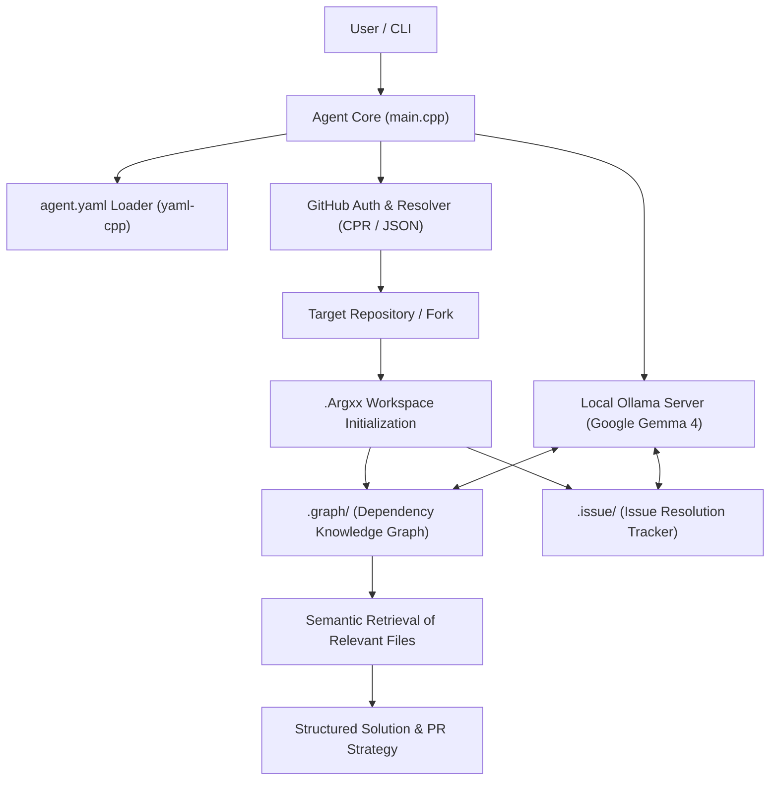

# Argxx 🤖

> **Local Autonomous AI Agent for Repository Issue Resolution and Code Knowledge Graphs**  
> *Built for the **Google Gemma 4 Agent Development Competition** on Kaggle.*

---

## 📌 Overview

GitHub is the global epicenter for open-source software collaboration, where developers coordinate bugs, enhancements, and features through **Issues** and **Pull Requests**. However, as codebases grow to thousands of files, a major hurdle emerges: **locating the exact files, dependency linkages, and architectural context needed to solve an issue is tedious and error-prone.**

**Argxx** is an autonomous AI agent running entirely on **local developer hardware**, purpose-built for the **Google Gemma 4 Agent Development Competition**. Powered by Google's Gemma model family served locally via Ollama, Argxx combines deterministic graph analysis, GitHub REST API integration, and Gemma's code comprehension capabilities to:
1. Navigate and inspect forked repositories.
2. Construct a local codebase knowledge graph (`.Argxx/.graph`).
3. Maintain an active issue resolution tracker (`.Argxx/.issue`).
4. Perform semantic retrieval to pinpoint the exact source files required to resolve GitHub issues.

---

## 🚀 Key Features

- **💻 Local Google Gemma 4 Orchestration**: Optimized for running Google Gemma 4 models (e.g. `gemma-4-e4b`) locally through Ollama, achieving rapid on-device inference with zero cloud data exposure or subscription costs.
- **⚙️ Declarative Agent Configuration (`agent.yaml`)**: Centralized control over Gemma's system prompts, token limits, and permitted execution tools.
- **🔑 GitHub Integration**: Authenticates using a GitHub Personal Access Token (`PAT`) to auto-discover user forks and resolve target repository contexts via CPR and the GitHub REST API.
- **🧠 Local Knowledge Graph (`.Argxx/.graph`)**: Inspects repository layout and builds a graph of file dependencies, symbols, and cross-references.
- **📋 Local Issue Tracking (`.Argxx/.issue`)**: Logs issues locally and outlines step-by-step resolution plans.
- **🔍 Semantic Retrieval**: Employs semantic analysis to pinpoint which source files are relevant to a reported bug or feature request.
- **⚡ High-Performance C++ Core**: Built with modern C++17, CMake with auto-dependency management, CPR, nlohmann/json, yaml-cpp, and dotenv-cpp.

---

## 🏗️ Architecture & Workflow



---

## 📁 Repository Layout

```text
Argxx/
├── Agent.cpp            # Agent initialization, YAML configuration parsing, and model orchestration
├── Agent.hpp            # Agent interface declarations
├── GithubAccount.cpp    # GitHub REST API authentication and repository resolution
├── GithubAccount.hpp    # GitHub interface declarations
├── main.cpp             # Application entry point
├── agent.yaml           # Declarative agent configuration (model, prompt, tools)
├── .env                 # Local environment secrets (GITHUB_TOKEN / PAT_TOKEN)
├── CMakeLists.txt       # Build system with CONFIGURE_DEPENDS and FetchContent
├── LICENSE              # License terms
└── README.md            # Project documentation
```

---

## 🛠️ Prerequisites

1. **C++17 Compiler** (Clang / GCC / Apple Clang)
2. **CMake** (v3.15 or newer)
3. **Homebrew Dependencies** (macOS):
   ```bash
   brew install cpr nlohmann-json yaml-cpp
   ```
4. **Ollama**:
   Install Ollama to serve Google Gemma locally:
   ```bash
   # Start Ollama service
   ollama serve

   # Pull local Gemma 4 model (or your chosen Gemma variant)
   ollama pull gemma:4b
   ```

---

## ⚙️ Configuration

### 1. Environment Secrets (`.env`)
Create a `.env` file in the project root:
```env
PAT_TOKEN=your_github_personal_access_token_here
```
> Argxx automatically loads `.env` variables via `dotenv-cpp` and preserves existing environment variables in CI/CD environments.

### 2. Agent Configuration (`agent.yaml`)
Customize your agent behaviors, model provider, and system prompts:
```yaml
version: "1.0"

agent:
  name: "Argxx"
  description: |
    Autonomous AI agent running on local hardware to map repository structure
    and guide issue resolution.
  
  model:
    provider: "ollama"
    name: "gemma:4b"
    max_tokens: 1500

  auth:
    type: "pat"
    token_env_var: "PAT_TOKEN"    

  system_prompt: |
    You are a senior-most engineer inspecting a repository to resolve issues.
    Construct a knowledge graph of relevant files and outline solutions inside .Argxx/.issue.

  tools:
    - name: "web_search"
      enabled: true
    - name: "github_api"
      enabled: true
```

---

## 🔨 Building and Running

CMake uses `CONFIGURE_DEPENDS` to automatically detect any new `.cpp` or `.hpp` files you add without requiring manual reconfiguration.

### 1. Build
```bash
cmake -B build
cmake --build build
```

### 2. Run
```bash
./build/agent
```

---

## 🏆 Competition Objective & Roadmap

Argxx is engineered for the **Google Gemma 4 Agent Development Competition**, demonstrating how Google's open Gemma models can autonomously drive developer workflows directly on local hardware without cloud dependencies.

- [x] GitHub REST API integration and automated fork resolution.
- [x] Environment variable loading via `dotenv-cpp` and declarative config via `yaml-cpp`.
- [x] Dynamic build system with automatic file tracking.
- [ ] Local Ollama HTTP API connector for Google Gemma 4 completion and tool calling.
- [ ] AST parsing and call-graph generation for the `.Argxx/.graph` knowledge engine.
- [ ] Local vector embedding pipeline for semantic codebase retrieval.
- [ ] Automated end-to-end patch generation and validation driven by Gemma 4.

---

## 📜 License

Distributed under the Apache-2.0 License. See [LICENSE](LICENSE) for more details.
